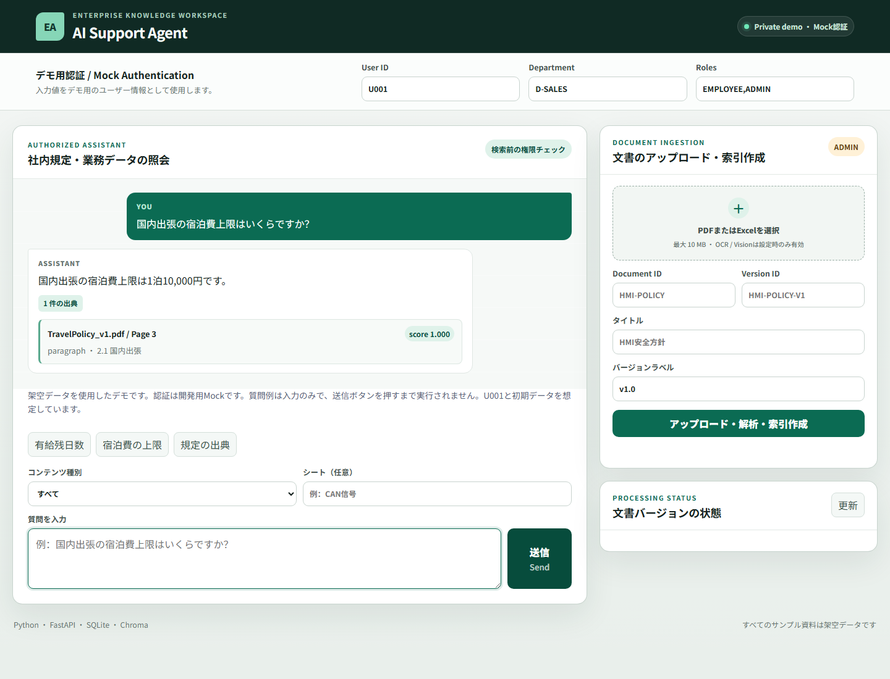
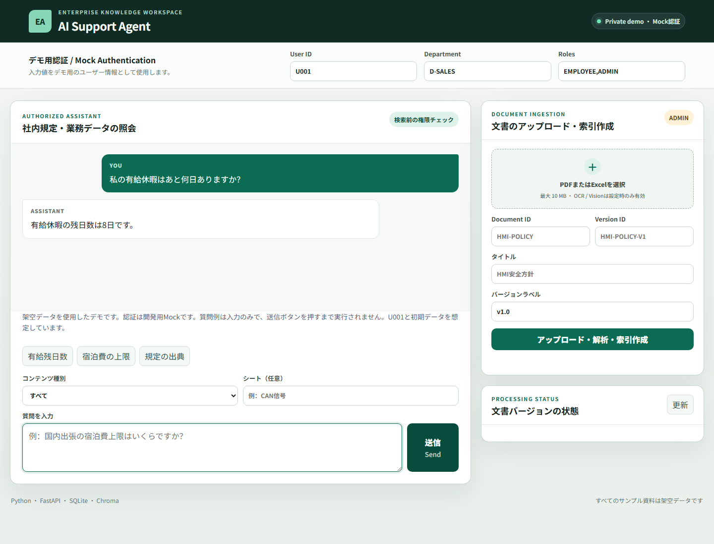
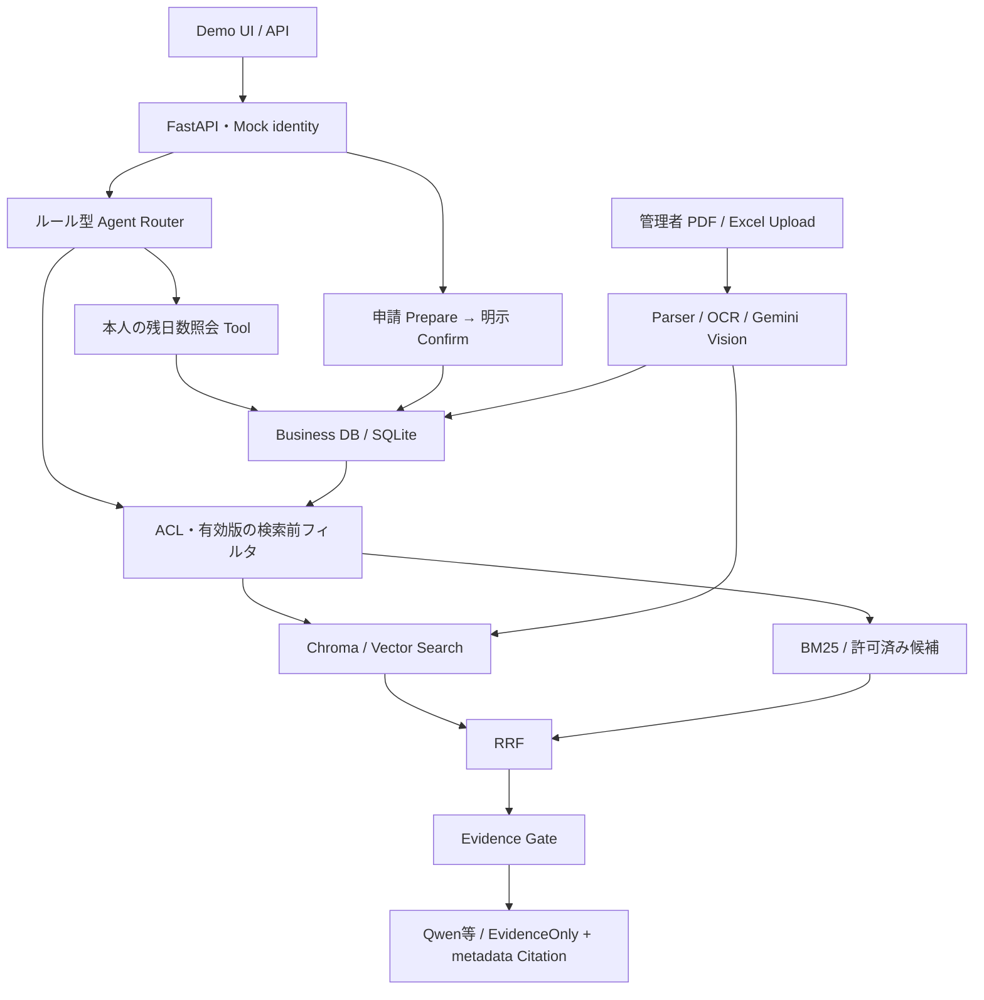

# Enterprise AI Support Agent

**社内資料を探す、根拠を確認する、有給休暇の残日数を調べる。これらを一つの画面で行える、企業向けAIアシスタントの個人開発作品です。**

PDF・Excelに分散した社内規定を自然な言葉で質問でき、回答と一緒に元の文書・ページなどの出典を確認できます。ユーザーごとの閲覧権限を検索前に適用し、根拠が不足する場合は回答を控える設計です。

**開発範囲：** Python / FastAPIによるAPI、権限制御付きRAG、業務Tool、日本語Demo UI、Docker / AWS EC2での私有デプロイまでを実装。

### 3つの主要機能

| 機能 | 利用シーン |
|---|---|
| **社内文書への質問・出典確認** | 「国内出張の宿泊費上限はいくらですか？」に回答し、根拠となるPDFのページを表示 |
| **本人の有給休暇残日数照会** | 「私の有給休暇はあと何日ありますか？」から本人の業務データを照会 |
| **確認付きの有給休暇申請** | 専用APIで申請内容を事前確認し、明示的な確定後に処理。再送による二重処理を防止 |

### 実際のDemo画面

架空データを使用したAWS私有Demoを、SSHポート転送経由でローカルPlaywrightから撮影（2026-10-13）。`U001 / D-SALES / EMPLOYEE,ADMIN`で日本語の回答・出典と現在の残日数を検証しました。

**社内文書への質問と出典確認**

「国内出張の宿泊費上限はいくらですか？」→ **1泊10,000円**。根拠：**TravelPolicy_v1.pdf / Page 3**。



**本人の有給休暇残日数照会**

「私の有給休暇はあと何日ありますか？」→ **8日**（撮影時の業務DBと一致）。本人の業務データを照会するため、PDFのCitationは付けません。



**主な技術：** Python / FastAPI · RAG / Chroma · Vector Search + BM25 + RRF · Qwen / DashScope Embedding · PDF / Excel · OCR / Gemini Vision · Docker / AWS

**実行環境：** 架空データを使用した検証用システムです。AWS EC2上でDockerによる私有環境のデプロイ・動作確認を行っています。認証は開発用Mock、チャットのTool選択はルール型Routerです。申請はチャットから直接実行せず、専用APIを使用します。

以下に実装、安全設計、検索評価と再現方法をまとめています。

## 実装した機能

| 領域 | 実装内容 |
|---|---|
| API・業務データ | Python、FastAPI、Pydantic、SQLAlchemy、SQLite。本人の有給休暇残日数を照会 |
| 権限制御付きRAG | Business DBのACL・有効な文書バージョンを**検索前**に適用。ChromaのVector SearchとBM25をRRFで統合 |
| 根拠と出典 | Evidence Gateで根拠不足時に回答を抑止。Citationは保存済みmetadataから生成（PDFページ、Excel Sheet / Cell Range、画像） |
| 文書取り込み | PDF / Excel Parser、管理者向けアップロード、文書バージョン管理、Google Cloud Vision OCR、Gemini Vision、権限付き原画像表示 |
| 実モデル接続 | DashScopeのtext-embedding-v4、Qwen回答生成。Gemini用Providerも実装。標準設定はオフラインのHash Embedding / EvidenceOnly回答 |
| Agent / Tool Calling | **ルール型Router**が残日数照会・文書検索の読み取りToolを選択。完全自律型のLLM Agentではない |
| 安全な申請 | Prepareでプレビューと確認tokenを発行。Confirmで再検証・残日数予約・申請作成・token消費を同一transactionで実行。冪等キーによる再送対策 |
| 配置・運用検証 | Docker / AWS EC2、S3によるデータ退避・復元、SSMによる秘密情報取得、CloudWatch Logsへのログ転送 |

**認証はMock Authenticationです。** `X-User-Id`等の自己申告Headerを使用しており、JWT等の本番認証は未実装です。ACL検証は実装していますが、このままインターネット公開する構成ではありません。自然言語チャットから申請を書き込む会話制御は未実装で、申請は専用APIを使用します。

## システム構成



EC2ではDockerのホスト側ポートを`127.0.0.1:8000`に限定し、SSHポート転送で閲覧します。SSMは設定・秘密情報、S3は退避データ、CloudWatchはログに使用します（文書検索をS3に直接実行する構成ではありません）。

## 検索評価

5つの架空PDF / Excel、60 Chunk、24問（回答可能21問・回答不能2問・ACL拒否1問）を使用。Top-Kは5です。以下は保存済みレポートの結果であり、今回の変更で外部API評価を再実行した値ではありません。

| Embedding・評価日 | 検索方式 | Hit@1 | Hit@5 | Recall@5 | MRR | Source Hit Rate |
|---|---|---:|---:|---:|---:|---:|
| Hash（2026-09-22） | Vector | 0.7143 | 1.0000 | 1.0000 | 0.8310 | 1.0000 |
| Hash（2026-09-22） | Hybrid | 0.6667 | 1.0000 | 1.0000 | 0.8056 | 1.0000 |
| text-embedding-v4 / 1024次元（2026-09-26） | Vector | 0.5714 | 1.0000 | 1.0000 | 0.7579 | 1.0000 |
| text-embedding-v4 / 1024次元（2026-09-26） | Hybrid | 0.7143 | 1.0000 | 1.0000 | 0.8135 | 1.0000 |

両評価のCitationは21/21、回答不能・ACL判断は3/3。回答モードは決定的な`evidence`、OCR / Visionは固定の模擬Providerです。**生成回答やクラウドOCRの総合精度を示す値ではありません。** 小規模な固定データセットであり、Hybridが常に優位という結果でもありません。

実EmbeddingのEvidence Gate閾値`0.36`はこのモデル・評価用文書で校正した値です。RRF順位スコアとは異なり、他のデータへの適用には再評価が必要です。[評価方法・制約・実モデル結果](docs/evaluation/real_corpus_evaluation_report.md)

## Demoの起動と質問例

ログイン不要の読み取り専用版は、独立入口 `app.public_demo:app` で第一段階のローカル実装を用意しています。AWSへの公開は未実施です。[Public Demoの起動・安全境界・制約](docs/public_demo_security.md)

独立した非rootコンテナのローカル検証・資源予算・承認後の配置/rollbackは[Public Demo Docker手順](docs/public_demo_docker.md)を参照してください。現在はnetwork noneで、ホストのポートを公開しません。

新しいローカル検証環境で実行します。seedは残日数を8日にリセットするため、既存のEC2データに対して実行しないでください。

```powershell
py -3.12 -m venv .venv
.\.venv\Scripts\Activate.ps1
python -m pip install -e ".[test]"
python -m app.db.seed
python -m uvicorn app.main:app --host 127.0.0.1 --port 8000
```

[Demo UI](http://127.0.0.1:8000/) / [Swagger UI](http://127.0.0.1:8000/docs)を開き、User IDを`U001`に設定します。入力欄近くの「質問例」はクリックで入力され、**送信ボタンを押すまで問い合わせません**。標準seedで検証できる例：

| 質問 | 確認できる内容 |
|---|---|
| 私の有給休暇はあと何日ありますか？ | 本人の残日数8日（申請後は変化） |
| 国内出張の宿泊費上限はいくらですか？ | 1泊10,000円、TravelPolicy_v1.pdf / Page 3 |
| 国内出張の宿泊費上限の出典を教えてください。 | 同じ規定のCitation |

`U999 / D-OTHER / EMPLOYEE`に切り替え、宿泊費を再質問するとseed文書の読み取り権限がないため根拠なしになります。画像付きCitationにはOCR / Visionで取り込んだ別の文書が必要です。オフライン画像確認は`python -m scripts.image_acceptance_demo`で起動し、「虚构导航画面保持显示」を質問します。この入口のVision出力は模擬です。

申請はSwaggerで`POST /api/me/leave-requests/prepare`に開始日・終了日を渡し、プレビューを確認後、`POST /api/me/leave-requests`へ`confirmation_token`・`confirmed: true`と`Idempotency-Key`を送ります。[安全な書き込みの設計](docs/03_detailed_design.md)

実モデル・OCR設定、明示的なliveテスト、SSHによる私有AWS検証の詳細は[設定・検証記録](docs/implementation_history.md)を参照してください。鍵は環境変数等で設定し、Gitに保存しません。Embedding変更時は別collectionへ再索引します。

## テスト・詳細資料

```powershell
python -m pytest -q
node --test tests/*.test.cjs
python -m scripts.run_corpus_evaluation
```

クラウドliveテストは明示的な有効化が必要で、通常の回帰では外部サービスに送信しません。

- [詳細設計・安全なTool実行](docs/03_detailed_design.md)
- [実ファイル検索評価](docs/evaluation/real_corpus_evaluation_report.md)
- [初期の小型回帰評価](docs/evaluation/day4_retrieval_report.md)
- [複雑文書解析の設計](docs/complex_document_upgrade_plan.md)
- [開発記録](docs/development_journal.md) / [実装進捗](docs/phase4_progress.md)
- [技術説明・面接用メモ](docs/interview_notes.md)
- [Provider設定・過去の検証記録](docs/implementation_history.md)
- [私有EC2の更新・ロールバック手順](docs/private_ec2_update.md)
- [GitHubプロフィール用紹介案と設定方法](docs/github_profile.md)

今後の課題は本番認証、申請用の構造化会話状態、評価データの拡充です。現在のMock認証環境は私有アクセスに限定します。

## 資格

開発者資格：**AWS Certified Generative AI Developer – Professional (AIP-C01)** — [Credlyで検証](https://www.credly.com/badges/265b8796-e4b7-443a-8a57-479f84b083e0/public_url)
