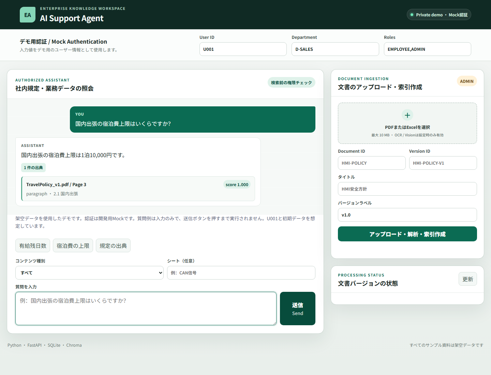
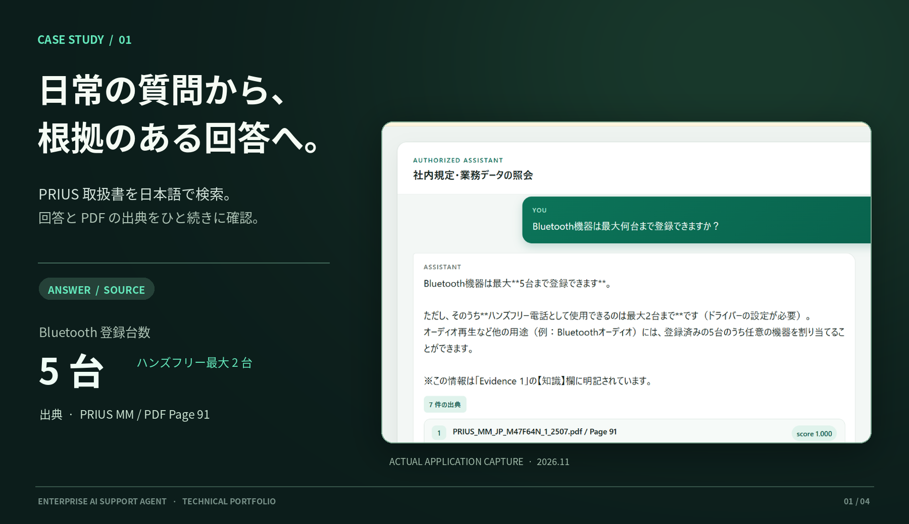
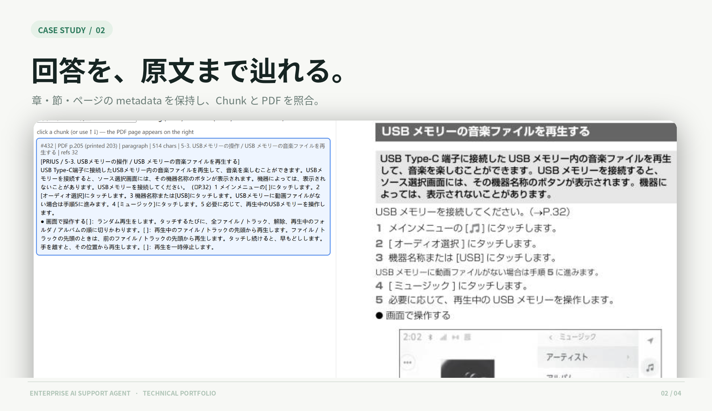
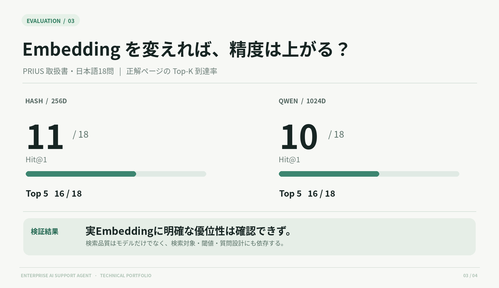
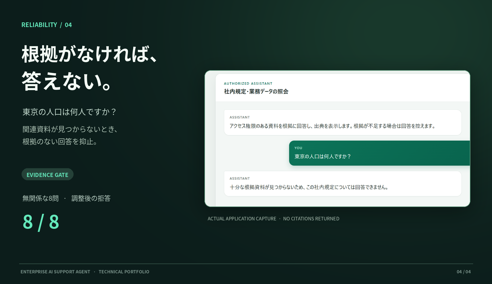
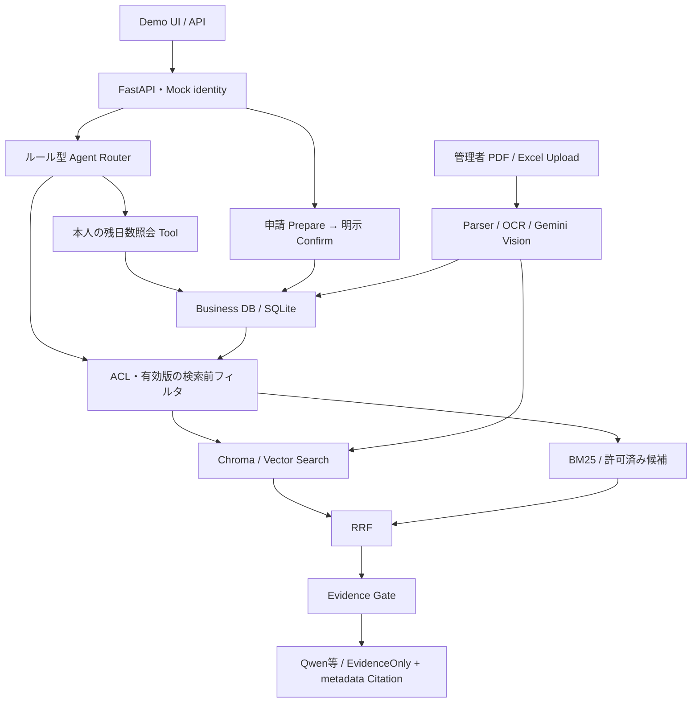

# Enterprise AI Support Agent

社内規程の根拠を確かめたいときと、自分の有給休暇を調べたいときに、同じ画面から問い合わせができる日本語の業務アシスタントです。Python / FastAPI で、文書の取り込み、閲覧権限に応じた検索、出典表示、業務 API を実装し、Docker と AWS EC2 のプライベート環境で動作を確認しました。

| 利用場面 | システムの動作 |
|---|---|
| 社内規程を調べる | 閲覧できる有効版の PDF・Excel に絞り、Chroma のベクトル検索と BM25 の順位を RRF で統合。根拠が十分なら回答と該当ページ・セル範囲を返す |
| 自分の有休を確認する | チャットのルールベースのルーターが照会用ツールを選び、本人の残日数を業務 DB から取得する |
| 有休を申請する | 専用 API で申請内容をプレビューし、利用者の確定後に登録する。確認トークンと冪等キーで二重処理を防ぐ |

## 社内業務での実行例

「国内出張の宿泊費上限はいくらですか？」という質問に、**1泊10,000円**と回答し、根拠の `TravelPolicy_v1.pdf` 3ページを表示します。有休残日数の照会は本人の業務データを参照します。以下は架空データを用いた EC2 検証環境の記録です。




撮影時の残日数は8日です。この値は本人の業務データから取得しています。

## PRIUS 取扱書の検索例

### Bluetooth 機器は最大何台まで登録できるか



画面には「登録は最大5台、うちハンズフリー電話として使えるのは最大2台」と表示されます。最初の出典に挙がった PDF 91ページを開くと、この二つの数字を同じ箇条書きで確認できます。

| 確認するもの | 実際の内容（抜粋） |
|---|---|
| **画面に表示された回答** | Bluetooth機器は最大**5台**まで登録できます。ただし、そのうち**ハンズフリー電話として使用できるのは最大2台まで**です（ドライバーの設定が必要）。 |
| **取扱書の原文**　PDF 91ページ／冊子89ページ「知識」 | Bluetooth® 機器は、5 台まで登録できますが、ハンズフリー電話として使用できるのは最大2 台までです。（ハンズフリー電話を2 台接続するには、ドライバーの設定が必要です。） |
| **Chroma に保存したチャンク**　`chunk_index=193` | 【知識】<br>●Bluetooth®機器は、5台まで登録できますが、ハンズフリー電話として使用できるのは最大2台までです。（ハンズフリー電話を2台接続するには、ドライバーの設定が必要です。） |

### USB メモリーの再生手順を原文と照合する



左側は「USB メモリーの音楽ファイルを再生する」のチャンク、右側は対応する PDF 205ページ（冊子203ページ）です。USB メモリーを接続してオーディオを選択する手順を左右で読み比べられます。検索には左側のテキストを使い、右側の図は原文の確認用に表示します。

### Embedding を変えると正解ページの順位はどう変わるか



同じ日本語18問で、正解ページが1位に入ったのは Hash が11問、Qwen が10問でした。上位5件まで広げると、どちらも16問です。ここで数えたのは正解ページを取得できた質問の数です。生成した回答の正しさは別に評価する必要があります。

### 手元の資料で答えられない質問への応答



「東京の人口は何人ですか？」は取扱書の対象外です。画面には根拠が不足していることを伝えるメッセージだけが表示されます。この例では Evidence Gate が回答生成前に処理を止め、出典も返していません。図中の 8/8 は、閾値を調整した後に対象外の日本語8問すべてで回答を控えた結果です。

取扱書の著作権は権利者に帰属します。PDF 本体はリポジトリに含めていません。

## 実装とシステム構成

- **検索と権限制御**　業務 DB の ACL から閲覧可能な文書バージョンを取得し、ベクトル検索と BM25 の両方に適用します。RRF で順位を統合した後、Evidence Gate が根拠を選び、サーバーが保存済みメタデータから出典を組み立てます。
- **文書処理**　管理者用アップロード、文書バージョン管理、PDF のページ・Excel のシート名とセル範囲を保持します。一般文書には Google Cloud Vision OCR、Gemini Vision、権限付き原画像表示にも対応しています。
- **回答生成**　標準設定はローカルの Hash Embedding と根拠テキストを返す `evidence` モードです。検索用の Embedding と回答用のモデルは個別に設定できます。
- **業務 API**　FastAPI / SQLAlchemy / SQLite を使用。休暇申請の確定時に、再検証・残日数の予約・申請登録・確認トークンの消費を同じトランザクションで処理します。
- **認証の範囲**　デモは `X-User-Id` などのヘッダーを用いる開発用 Mock 認証です。閲覧権限の判定を実装し、本番向けの本人認証は今後の課題としています。



## AWS でのデプロイ検証

Docker を AWS EC2 に配置し、ホスト側ポートをループバックに限定して SSH ポート転送で動作を確認しました。SSM で設定と秘密情報を取得し、S3 へのバックアップ・復元と CloudWatch Logs へのログ転送を検証しました。以下は当時のプライベート環境の記録です。


EC2 上のアプリケーションが起動し、リクエストを受けた時のログです。[EC2・S3 の構成と検証記録](docs/aws-deployment-evidence/README.md)

## 検索評価

### PRIUS 取扱書での Embedding 比較

PRIUS 1冊（854チャンク）に対し、手作業で[31問の評価セット](docs/evaluation/toyota_prius_questions.csv)を作成しました。内訳は日本語26問（回答可能18問・対象外8問）、中国語5問（回答可能4問・対象外1問）です。両方式とも **ベクトル検索＋BM25＋RRF** を使用し、Hash と DashScope の `qwen3.7-text-embedding-flash` を別々の Chroma コレクションで比較しました。

| 日本語の回答可能18問 | Hit@1 | Hit@3 | Hit@5 |
|---|---:|---:|---:|
| Hash（256次元） | 11/18 | 14〜15/18 | 16/18 |
| Qwen（1024次元） | 10/18 | 15/18 | 16/18 |

Hit@k は、上位 k 件のチャンクのいずれかに正解ページが含まれた質問の割合です。Hash の Hit@3 は同じ設定でも1問分変動しました。この日本語セットでは Qwen の優位性は確認できませんでした。参考として、中国語の回答可能4問では Qwen が4問とも正解ページを上位5件に取得しました。

| 日本語の対象外8問で回答を控えた件数 | 既定の閾値（0.25 / 0.3） | 調整後 | 調整後の閾値 |
|---|---:|---:|---|
| Hash | 2/8 | 8/8 | 0.4 / 0.7 |
| Qwen | 0/8 | 8/8 | 0.5 / 0.7 |

閾値はベクトルスコアとキーワード一致率の順です。日本語の回答可能18問は、両方式とも調整前後で全問が Gate を通過しました。調整に使った質問と評価セットは一部重なるため、未知の質問に対する拒答率は別途検証が必要です。再現用コマンドは `python -m scripts.eval_toyota --verbose --sweep` です。

### 社内文書での評価

5つの架空PDF / Excel、60 Chunk、24問（回答可能21問・回答不能2問・ACL拒否1問）を使用。Top-Kは5です。以下は保存済みの評価結果です。

| Embedding・評価日 | 検索方式 | Hit@1 | Hit@5 | Recall@5 | MRR | Source Hit Rate |
|---|---|---:|---:|---:|---:|---:|
| Hash（2026-09-22） | Vector | 0.7143 | 1.0000 | 1.0000 | 0.8310 | 1.0000 |
| Hash（2026-09-22） | Hybrid | 0.6667 | 1.0000 | 1.0000 | 0.8056 | 1.0000 |
| text-embedding-v4 / 1024次元（2026-09-26） | Vector | 0.5714 | 1.0000 | 1.0000 | 0.7579 | 1.0000 |
| text-embedding-v4 / 1024次元（2026-09-26） | Hybrid | 0.7143 | 1.0000 | 1.0000 | 0.8135 | 1.0000 |

両評価のCitationは21/21、回答不能・ACL判断は3/3。回答モードは決定的な`evidence`、OCR / Visionは固定の模擬Providerです。**生成回答やクラウドOCRの総合精度を示す値ではありません。** 小規模な固定データセットであり、Hybridが常に優位という結果でもありません。

実EmbeddingのEvidence Gate閾値`0.36`はこのモデル・評価用文書で校正した値です。RRF順位スコアとは異なり、他のデータへの適用には再評価が必要です。[評価方法・制約・実モデル結果](docs/evaluation/real_corpus_evaluation_report.md)

## Qwen による回答生成と検証の限界

`RAG_ANSWER_MODE=qwen` で、Evidence Gate を通った根拠を `qwen-plus` に渡します。出典の文書名やページ番号はサーバーがメタデータから付与します。以下は**検索に Hash、回答生成に Qwen** を使う設定例です。取り込み済みの Hash インデックスと、環境変数 `DASHSCOPE_API_KEY` を用意してください。

```powershell
$env:RAG_EMBEDDING_MODE = "hash"
$env:RAG_ANSWER_MODE = "qwen"
$env:RAG_ANSWER_MODEL = "qwen-plus"
$env:RAG_MINIMUM_SCORE = "0.4"                    # Hash Embedding向けの調整後閾値
$env:RAG_MINIMUM_KEYWORD_MATCH_RATIO = "0.7"
python -m uvicorn app.main:app --host 127.0.0.1 --port 8000
```

- **検索と回答の評価範囲**　上の31問で集計したのはページの命中と根拠判定です。生成回答は4問を目視確認しました。Wi-Fi Hotspot の例では根拠に88ページだけが入り、必要な102ページの操作手順を回答できませんでした。回答が冗長になったり、利用者に不要な追加対応を求めたりする例もあります。
- **正解ページの定義**　ガイド線の意味を問う質問では、指定した296ページが上位5件から漏れました。他のページにも関連する説明があり、ページの完全一致だけでは回答の妥当性を判断できません。
- **図表と適用範囲**　取扱書専用パーサーは見出しとテキスト層を利用します。図の凡例・表・本文の対応や複雑な段組みの読み順には改善の余地があります。他の8冊では分割統計のみを確認しており、検索品質の検証は PRIUS 1冊に限られます。

## ローカルデモの起動と質問例

新しいローカル検証環境で実行します。seedは残日数を8日にリセットするため、既存のEC2データに対して実行しないでください。

```powershell
py -3.12 -m venv .venv
.\.venv\Scripts\Activate.ps1
python -m pip install -e ".[test]"
python -m app.db.seed
python -m uvicorn app.main:app --host 127.0.0.1 --port 8000
```

[Demo UI](http://127.0.0.1:8000/) / [Swagger UI](http://127.0.0.1:8000/docs)を開き、User IDを`U001`に設定します。入力欄近くの「質問例」はクリックで入力され、**送信ボタンを押すまで問い合わせません**。標準seedで検証できる例：

| 質問 | 確認できる内容 |
|---|---|
| 私の有給休暇はあと何日ありますか？ | 本人の残日数8日（申請後は変化） |
| 国内出張の宿泊費上限はいくらですか？ | 1泊10,000円、TravelPolicy_v1.pdf / Page 3 |
| 国内出張の宿泊費上限の出典を教えてください。 | 同じ規定のCitation |

`U999 / D-OTHER / EMPLOYEE`に切り替え、宿泊費を再質問するとseed文書の読み取り権限がないため根拠なしになります。画像付きCitationにはOCR / Visionで取り込んだ別の文書が必要です。オフライン画像確認は`python -m scripts.image_acceptance_demo`で起動し、「虚构导航画面保持显示」を質問します。この入口のVision出力は模擬です。

申請はSwaggerで`POST /api/me/leave-requests/prepare`に開始日・終了日を渡し、プレビューを確認後、`POST /api/me/leave-requests`へ`confirmation_token`・`confirmed: true`と`Idempotency-Key`を送ります。[安全な書き込みの設計](docs/03_detailed_design.md)

実モデル・OCR設定、明示的なliveテスト、SSHによるプライベート AWS 環境での検証の詳細は[設定・検証記録](docs/implementation_history.md)を参照してください。鍵は環境変数等で設定し、Gitに保存しません。Embedding変更時は別collectionへ再索引します。

## テスト・詳細資料

```powershell
python -m pytest -q
node --test tests/*.test.cjs
python -m scripts.run_corpus_evaluation
```

クラウドliveテストは明示的な有効化が必要で、通常の回帰では外部サービスに送信しません。

- [詳細設計・安全なTool実行](docs/03_detailed_design.md)
- [実ファイル検索評価](docs/evaluation/real_corpus_evaluation_report.md)
- [初期の小型回帰評価](docs/evaluation/day4_retrieval_report.md)
- [複雑文書解析の設計](docs/complex_document_upgrade_plan.md)
- [開発記録](docs/development_journal.md) / [実装進捗](docs/phase4_progress.md)
- [技術説明・面接用メモ](docs/interview_notes.md)
- [Provider設定・過去の検証記録](docs/implementation_history.md)
- [プライベート EC2 環境の更新・ロールバック手順](docs/private_ec2_update.md)
- [GitHubプロフィール用紹介案と設定方法](docs/github_profile.md)

今後の課題は本番認証、申請用の構造化会話状態、評価データの拡充です。現在のMock認証環境は限定公開で運用する想定です。

## 資格

**AWS Certified Generative AI Developer – Professional (AIP-C01)** — [Credlyで検証](https://www.credly.com/badges/265b8796-e4b7-443a-8a57-479f84b083e0/public_url)
