# Enterprise AI Support Agent

社内規程の根拠を確かめたいときと、自分の有給休暇を調べたいときに、同じ画面から問い合わせができる日本語の業務アシスタントです。Python / FastAPI で、文書の取り込み、閲覧権限に応じた検索、出典表示、業務 API を実装し、Docker と AWS EC2 のプライベート環境で動作を確認しました。

| 利用場面 | システムの動作 |
|---|---|
| 社内規程を調べる | 閲覧できる有効版の PDF・Excel に絞り、Chroma のベクトル検索と BM25 の順位を RRF で統合。根拠が十分なら回答と該当ページ・セル範囲を返す |
| 自分の有休を確認する | チャットのルールベースのルーターが照会用ツールを選び、本人の残日数を業務 DB から取得する |
| 有休を申請する | 専用 API で申請内容をプレビューし、利用者の確定後に登録する。確認トークンと冪等キーで二重処理を防ぐ |

## 社内業務での実行例

「国内出張の宿泊費上限はいくらですか？」という質問に、**1泊10,000円**と回答し、根拠の `TravelPolicy_v1.pdf` 3ページを表示します。有休残日数の照会は本人の業務データを参照します。以下は架空データを用いた EC2 検証環境の記録です。


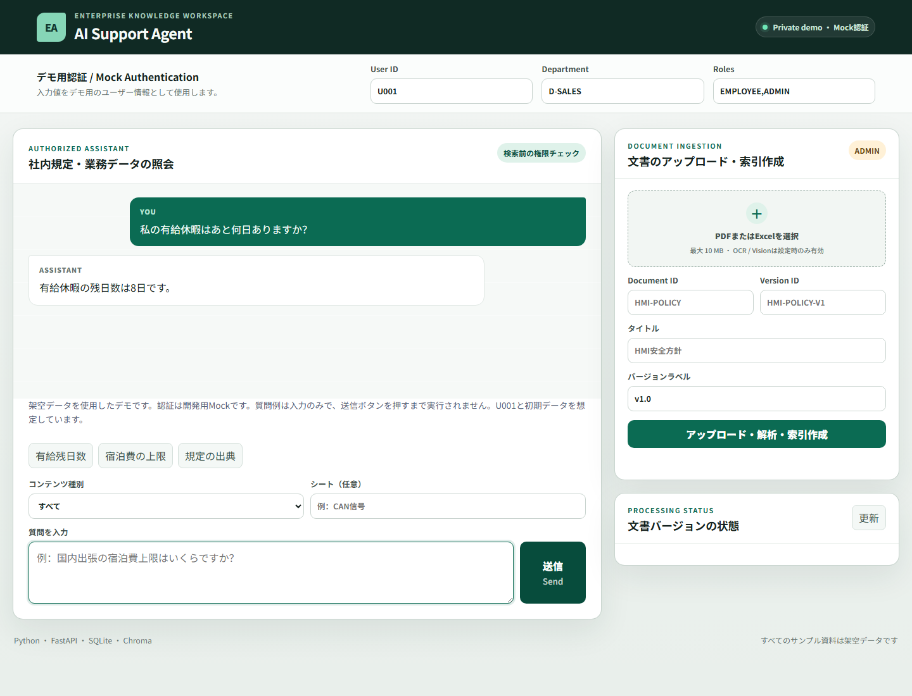

撮影時の残日数は8日です。この値は本人の業務データから取得しています。

## PRIUS 取扱書の検索例

### Bluetooth 機器は最大何台まで登録できますか？

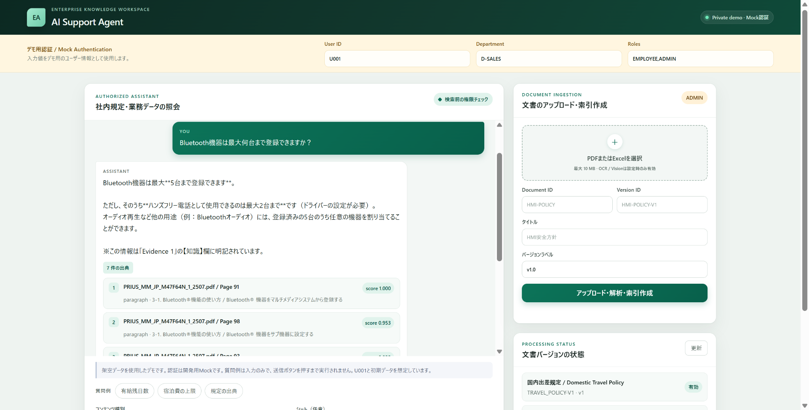

**回答。** 登録は最大5台、そのうちハンズフリー電話として使えるのは最大2台と回答し、最初の出典に PDF 91ページを示しました。

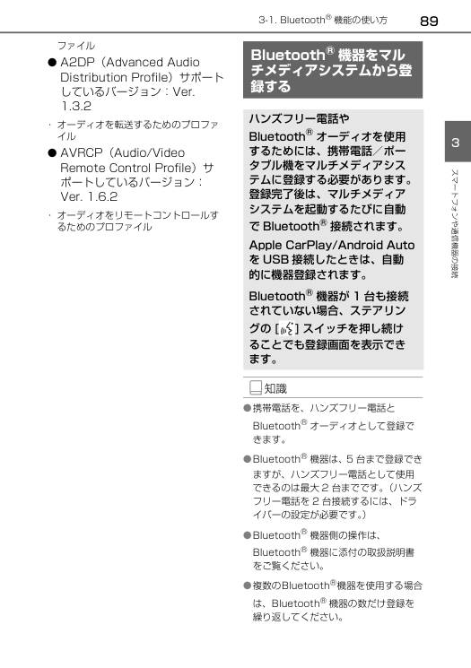

**原文。** PDF 91ページ（冊子89ページ）の右欄「知識」には、二つの上限と、電話を2台接続する際はドライバーの設定が必要という条件が一緒に書かれています。

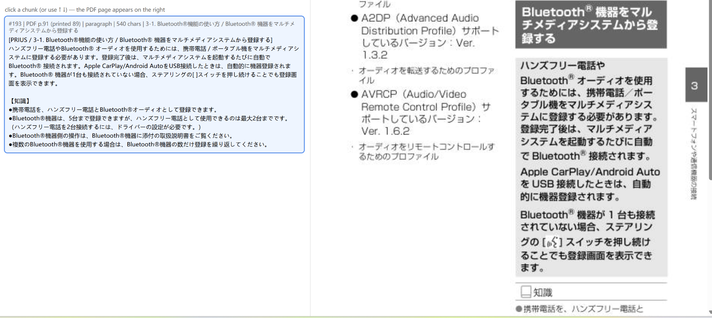

**チャンク。** 左の #193 にも「5台まで登録できますが、ハンズフリー電話として使用できるのは最大2台までです」という一文が残っています。

**分割で保ちたい情報**は、台数とその適用条件の組み合わせです。見出しと「知識」欄を同じチャンクに残すことで、回答に必要な二つの上限を一緒に取り出せます。保存したページ番号から、読み手も元の記述を確かめられます。

### USBメモリーの音楽を再生したい

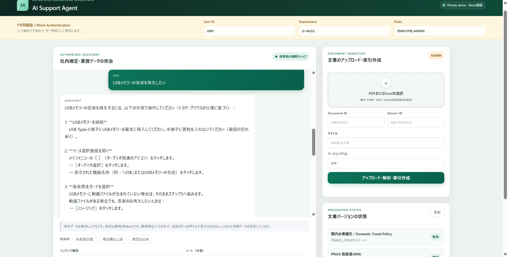

**回答。** USB メモリーを接続し、「オーディオ選択」で機器を選ぶところまで、操作順に案内しています。

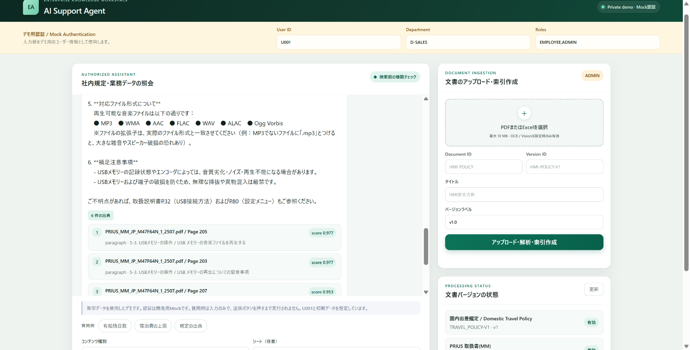

**回答の続きと出典。** 同じ回答を下にスクロールすると、6件の出典があり、先頭は「USB メモリーの音楽ファイルを再生する」の PDF 205ページです。

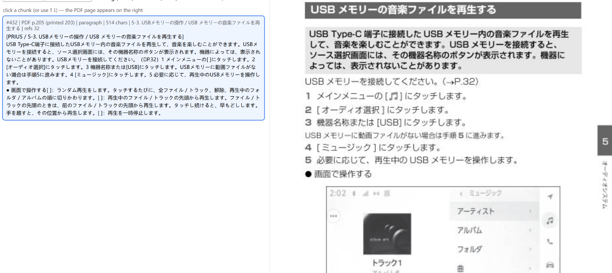

**原文とチャンク。** 左の #432 と右の PDF 205ページ（冊子203ページ）には、「オーディオ選択」から機器を選ぶ手順と、動画ファイルがなければ手順5へ進む分岐があります。

この例では、操作名だけでなく**手順の順序と分岐**が抽出後も残っているかを確認できます。一方、PDF の手順1にある音符アイコンはチャンク内で空の角括弧になっています。テキスト抽出で失われた情報も、原文を並べると特定できます。

### 東京の人口は何人ですか？

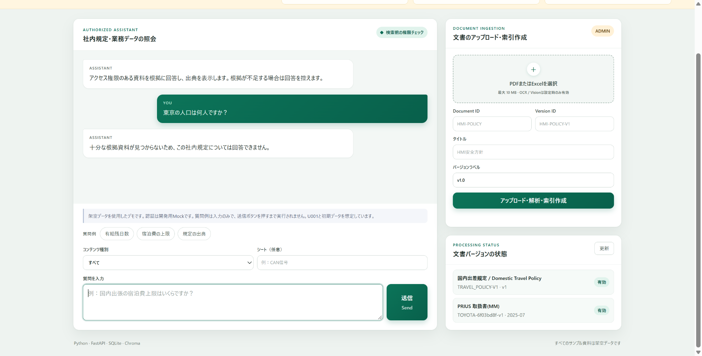

**根拠が不足した場合の応答。** 画面には根拠資料が見つからなかった旨が表示され、人口の推測値も出典も返していません。

Evidence Gate は検索後、回答生成の前に根拠の十分性を判定します。この例のように条件を満たすチャンクがなければ、その時点で処理を終えます。

### ガイド画面に表示される線は何を表していますか？

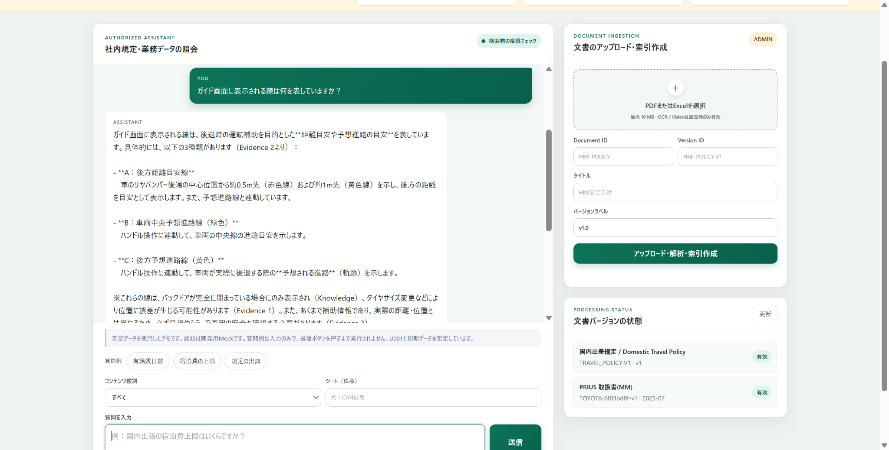

**回答。** 後退時のガイド線を A・B・C に分けて説明し、その説明の根拠として「Evidence 2」を挙げています。

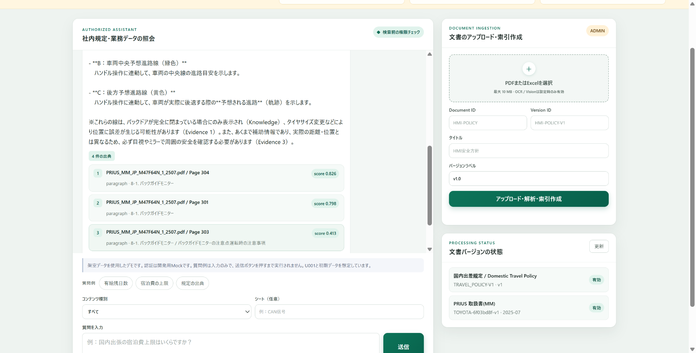

**出典。** 一覧の2件目は PDF 301ページです。最初に表示された304ページとは別に、線の説明に使った箇所を追えます。

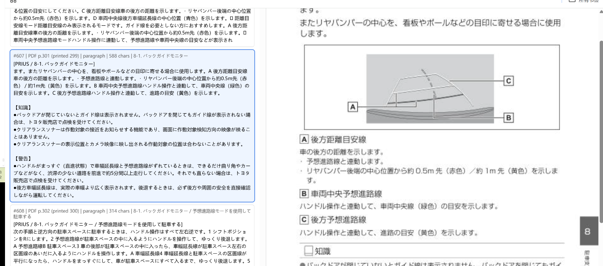

**原文とチャンク。** PDF 301ページ（冊子299ページ）の図には A・B・C の凡例があり、左の #607 にも対応する線の名称と説明が含まれています。

**この例は検索評価の限界も示しています。** 評価セットで指定した正解ページは296ページで、上位5件には入りませんでした。一方、回答に出た線の説明の一部は301ページで確認できます。ページ命中率に加え、回答の各記述を実際の出典が裏付けているかを見る必要があります。

取扱書の著作権は権利者に帰属します。PDF 本体はリポジトリに含めていません。

## 実装とシステム構成

- **検索と権限制御**　業務 DB の ACL から閲覧可能な文書バージョンを取得し、ベクトル検索と BM25 の両方に適用します。RRF で順位を統合した後、Evidence Gate が根拠を選び、サーバーが保存済みメタデータから出典を組み立てます。
- **文書処理**　管理者用アップロード、文書バージョン管理、PDF のページ・Excel のシート名とセル範囲を保持します。一般文書には Google Cloud Vision OCR、Gemini Vision、権限付き原画像表示にも対応しています。
- **回答生成**　標準設定はローカルの Hash Embedding と根拠テキストを返す `evidence` モードです。検索用の Embedding と回答用のモデルは個別に設定できます。
- **業務 API**　FastAPI / SQLAlchemy / SQLite を使用。休暇申請の確定時に、再検証・残日数の予約・申請登録・確認トークンの消費を同じトランザクションで処理します。
- **認証の範囲**　デモは `X-User-Id` などのヘッダーを用いる開発用 Mock 認証です。閲覧権限の判定を実装し、本番向けの本人認証は今後の課題としています。

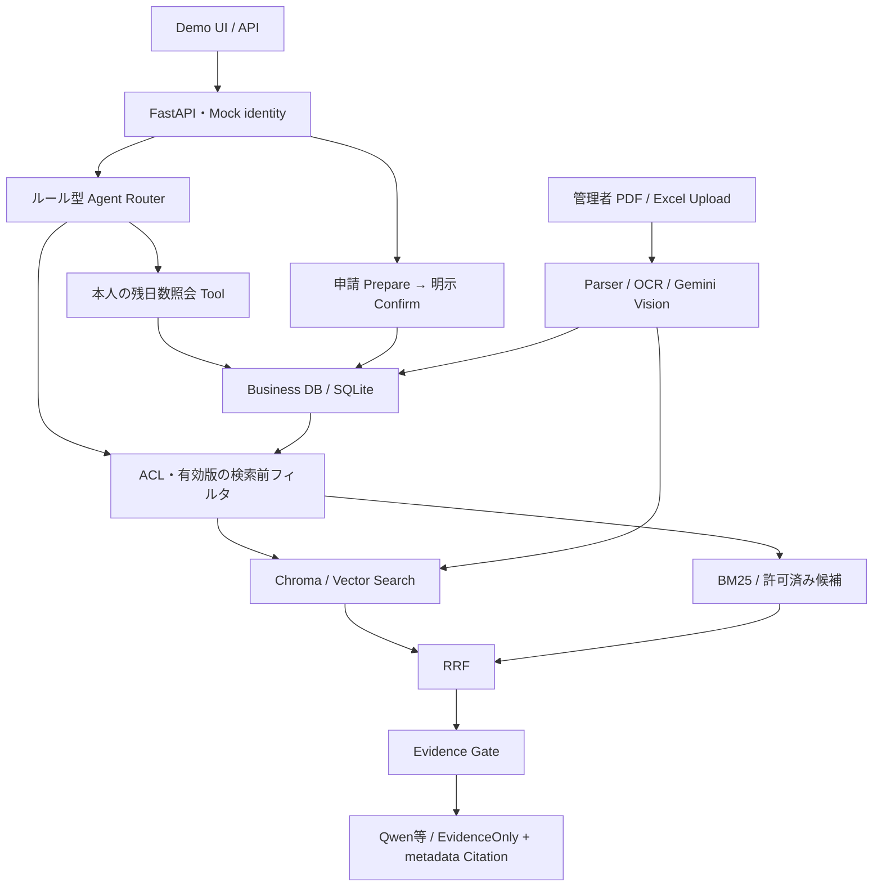

## AWS でのデプロイ検証

Docker を AWS EC2 に配置し、ホスト側ポートをループバックに限定して SSH ポート転送で動作を確認しました。SSM で設定と秘密情報を取得し、S3 へのバックアップ・復元と CloudWatch Logs へのログ転送を検証しました。以下は当時のプライベート環境の記録です。

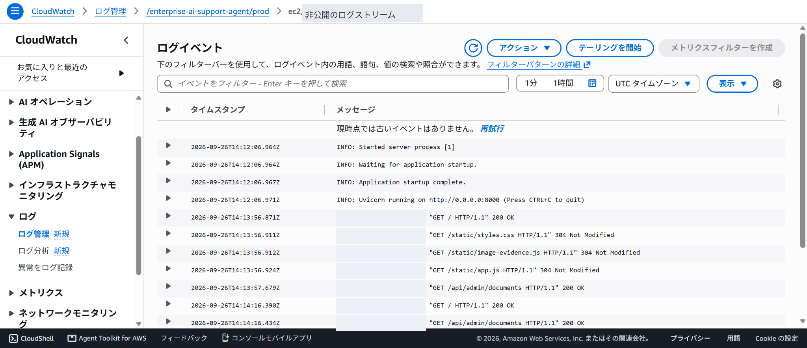

EC2 上のアプリケーションが起動し、リクエストを受けた時のログです。[EC2・S3 の構成と検証記録](docs/aws-deployment-evidence/README.md)

## 検索評価

### PRIUS 取扱書での Embedding 比較

PRIUS 1冊（854チャンク）に対し、手作業で[31問の評価セット](docs/evaluation/toyota_prius_questions.csv)を作成しました。内訳は日本語26問（回答可能18問・対象外8問）、中国語5問（回答可能4問・対象外1問）です。両方式とも **ベクトル検索＋BM25＋RRF** を使用し、Hash と DashScope の `qwen3.7-text-embedding-flash` を別々の Chroma コレクションで比較しました。

| 日本語の回答可能18問 | Hit@1 | Hit@3 | Hit@5 |
|---|---:|---:|---:|
| Hash（256次元） | 11/18 | 14〜15/18 | 16/18 |
| Qwen（1024次元） | 10/18 | 15/18 | 16/18 |

Hit@k は、上位 k 件のチャンクのいずれかに正解ページが含まれた質問の割合です。Hash の Hit@3 は同じ設定でも1問分変動しました。この日本語セットでは Qwen の優位性は確認できませんでした。参考として、中国語の回答可能4問では Qwen が4問とも正解ページを上位5件に取得しました。

| 日本語の対象外8問で回答を控えた件数 | 既定の閾値（0.25 / 0.3） | 調整後 | 調整後の閾値 |
|---|---:|---:|---|
| Hash | 2/8 | 8/8 | 0.4 / 0.7 |
| Qwen | 0/8 | 8/8 | 0.5 / 0.7 |

閾値はベクトルスコアとキーワード一致率の順です。日本語の回答可能18問は、両方式とも調整前後で全問が Gate を通過しました。調整に使った質問と評価セットは一部重なるため、新たな対象外の質問でも適切に回答を控えられるかは、別途検証する必要があります。再現用コマンドは `python -m scripts.eval_toyota --verbose --sweep` です。

### 社内文書での評価

架空の社内文書5件（PDF・Excel、計60チャンク）を対象に、24問で評価しました。内訳は回答可能な質問21問、資料に答えがない質問2問、閲覧権限のない利用者からの質問1問です。各質問の検索結果は上位5件までを評価しました。以下は保存済みの評価結果です。

| Embedding・評価日 | 検索方式 | Hit@1 | Hit@5 | Recall@5 | MRR | Source Hit Rate |
|---|---|---:|---:|---:|---:|---:|
| Hash（2026-09-22） | Vector | 0.7143 | 1.0000 | 1.0000 | 0.8310 | 1.0000 |
| Hash（2026-09-22） | Hybrid | 0.6667 | 1.0000 | 1.0000 | 0.8056 | 1.0000 |
| text-embedding-v4 / 1024次元（2026-09-26） | Vector | 0.5714 | 1.0000 | 1.0000 | 0.7579 | 1.0000 |
| text-embedding-v4 / 1024次元（2026-09-26） | Hybrid | 0.7143 | 1.0000 | 1.0000 | 0.8135 | 1.0000 |

両方の評価で、回答可能な21問すべてに出典を表示し、資料に答えがない場合と閲覧権限がない場合の計3問では回答を控えました。回答には根拠の本文を返す `evidence` モードを使い、OCR と画像認識には固定の結果を返すテスト用の実装を使いました。**生成回答やクラウドOCRの総合精度を示す値ではありません。** 小規模な固定データセットであり、Hybridが常に優位という結果でもありません。

実EmbeddingのEvidence Gate閾値`0.36`はこのモデル・評価用文書で校正した値です。RRF順位スコアとは異なり、他のデータへの適用には再評価が必要です。[評価方法・制約・実モデル結果](docs/evaluation/real_corpus_evaluation_report.md)

## Qwen による回答生成と検証の限界

`RAG_ANSWER_MODE=qwen` で、Evidence Gate を通った根拠を `qwen-plus` に渡します。出典の文書名やページ番号はサーバーがメタデータから付与します。以下は**検索に Hash、回答生成に Qwen** を使う設定例です。取り込み済みの Hash インデックスと、環境変数 `DASHSCOPE_API_KEY` を用意してください。

```powershell
$env:RAG_EMBEDDING_MODE = "hash"
$env:RAG_ANSWER_MODE = "qwen"
$env:RAG_ANSWER_MODEL = "qwen-plus"
$env:RAG_MINIMUM_SCORE = "0.4"                    # Hash Embedding向けの調整後閾値
$env:RAG_MINIMUM_KEYWORD_MATCH_RATIO = "0.7"
python -m uvicorn app.main:app --host 127.0.0.1 --port 8000
```

- **検索と回答の評価範囲**　上の31問で集計したのはページの命中と根拠判定です。生成回答は4問を目視確認しました。Wi-Fi Hotspot の例では根拠に88ページだけが入り、必要な102ページの操作手順を回答できませんでした。回答が冗長になったり、利用者に不要な追加対応を求めたりする例もあります。
- **正解ページの定義**　ガイド線の意味を問う質問では、指定した296ページが上位5件から漏れました。他のページにも関連する説明があり、ページの完全一致だけでは回答の妥当性を判断できません。
- **図表と適用範囲**　取扱書専用パーサーは見出しとテキスト層を利用します。図の凡例・表・本文の対応や複雑な段組みの読み順には改善の余地があります。他の8冊では分割統計のみを確認しており、検索品質の検証は PRIUS 1冊に限られます。

## ローカルデモの起動と質問例

以下は新しいローカル検証環境で実行してください。初期データを投入すると有休の残日数が8日に戻ります。

```powershell
py -3.12 -m venv .venv
.\.venv\Scripts\Activate.ps1
python -m pip install -e ".[test]"
python -m app.db.seed
python -m uvicorn app.main:app --host 127.0.0.1 --port 8000
```

[デモ画面](http://127.0.0.1:8000/)でユーザー ID を `U001` に設定します。入力欄の近くにある「質問例」を選び、送信ボタンを押すと、以下の内容を初期データで確認できます。API を直接試す場合は [Swagger UI](http://127.0.0.1:8000/docs) を開いてください。

| 質問 | 確認できる内容 |
|---|---|
| 私の有給休暇はあと何日ありますか？ | 本人の残日数8日（申請後は変化） |
| 国内出張の宿泊費上限はいくらですか？ | 1泊10,000円、TravelPolicy_v1.pdf / Page 3 |
| 国内出張の宿泊費上限の出典を教えてください。 | 同じ規程の出典 |

`U999 / D-OTHER / EMPLOYEE` に切り替えて同じ宿泊費を尋ねると、この利用者には出張規程の閲覧権限がないため、根拠不足のメッセージが表示されます。

画像付きの出典は、別のローカルデモで確認できます。`python -m scripts.image_acceptance_demo` を実行し、起動時に端末の `Question:` に表示される質問文を `U001` で入力してください。このデモでは画像認識の結果に固定のサンプルを使います。

申請はSwaggerで`POST /api/me/leave-requests/prepare`に開始日・終了日を渡し、プレビューを確認後、`POST /api/me/leave-requests`へ`confirmation_token`・`confirmed: true`と`Idempotency-Key`を送ります。[安全な書き込みの設計](docs/03_detailed_design.md)

外部モデルと OCR の設定、実際の API を使うテスト、SSH 経由での AWS 検証手順は[設定・検証記録](docs/implementation_history.md)を参照してください。API キーは環境変数などで管理します。埋め込みモデルを変更する際は、別のコレクションにインデックスを構築します。

## テスト・詳細資料

```powershell
python -m pytest -q
node --test tests/*.test.cjs
python -m scripts.run_corpus_evaluation
```

外部サービスを呼び出すテストは、明示的に有効にした場合にのみ実行されます。

- [詳細設計と業務ツールの実行手順](docs/03_detailed_design.md)
- [実ファイル検索評価](docs/evaluation/real_corpus_evaluation_report.md)
- [初期の小型回帰評価](docs/evaluation/day4_retrieval_report.md)
- [複雑なレイアウトの文書を解析するための設計](docs/complex_document_upgrade_plan.md)
- [開発記録](docs/development_journal.md) / [実装進捗](docs/phase4_progress.md)
- [技術説明・面接用メモ](docs/interview_notes.md)
- [モデル接続の設定・過去の検証記録](docs/implementation_history.md)
- [プライベート EC2 環境の更新・ロールバック手順](docs/private_ec2_update.md)
- [GitHubプロフィール用紹介案と設定方法](docs/github_profile.md)

今後の課題は本番認証、申請用の構造化会話状態、評価データの拡充です。現在のMock認証環境は限定公開で運用する想定です。

## 資格

**AWS Certified Generative AI Developer – Professional (AIP-C01)** — [Credlyで検証](https://www.credly.com/badges/265b8796-e4b7-443a-8a57-479f84b083e0/public_url)
