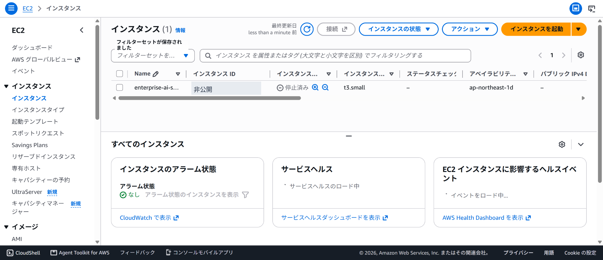
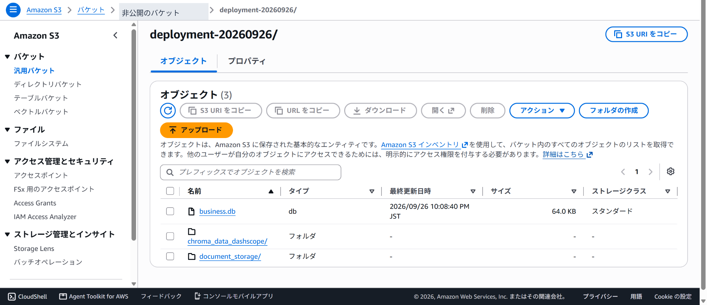
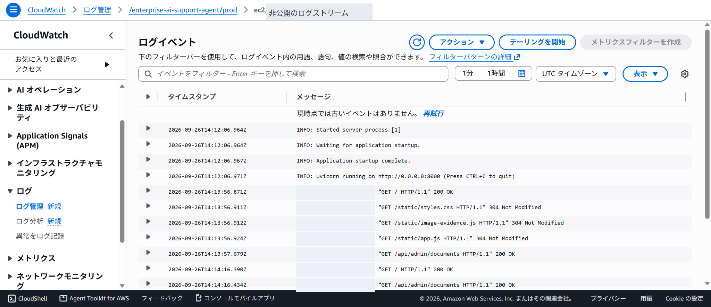

# AWS プライベートデプロイの検証証跡（2026年9月）

2026年9月、架空データを用いた Enterprise AI Support Agent を AWS EC2 上の Docker コンテナでプライベートに動作検証しました。**本ページは当時の構成・動作に関する証拠であり、現在の一般公開・本番認証・セキュリティ審査の合格を意味しません。**

- **EC2:** `t3.small` を用いた検証環境。画像は撮影時にインスタンスが停止中であったことを示します。
- **S3:** 業務データベース（`business.db`）、Chroma ベクトルインデックスおよび文書ストレージのバックアップ配置。
- **CloudWatch Logs:** FastAPI / Uvicorn の起動と HTTP 200 レスポンス等のアプリケーション動作ログ。
- **検証方法:** Docker コンテナの外部公開ポートを制限し、SSH ポート転送経由で RAG の操作を確認しました。

以下の画像では、AWS アカウント情報、EC2 インスタンス ID、S3 バケット名、一部のリソース識別子と内部アクセス元アドレスをマスクしています。

## EC2 インスタンス

## S3 バックアップ

## CloudWatch Logs

実際の日本語 RAG デモ画面は [文書検索と出典](../images/rag-query.png) および [本人の有給残日数照会](../images/leave-balance.png) をご参照ください。

> 注意：これらは AWS の動作確認を示す証跡です。新しいネットワーク公開設定、セキュリティ例外、インターネット向けアクセス制御などの承認を意味しません。
